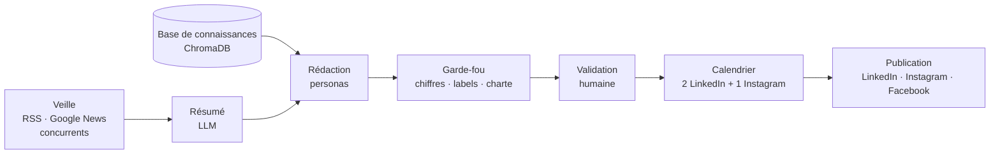
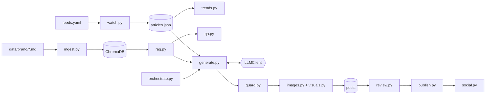

<div align="center">

# Copilote Marketing

**IA générative · RAG · automatisation social media**
<br>
Veille du marché → base de connaissances de la marque → 3 posts par semaine → validation humaine → publication programmée


**[▶ Démo en ligne](https://copilote-marketing-brasserie.netlify.app)** · lecture seule, données réelles générées avec Gemini

[Résultats réels](#3-résultats-avec-gemini) · [Démarrage rapide](#2-démarrage-rapide) · [Rapport d'audit](docs/AUDIT_CONFORMITE.md) · [Exemples de posts](out/examples/)

</div>

> [!NOTE]
> **Contexte.** Prototype réalisé dans le cadre d'une candidature au stage « Ingénieur(e) IA Générative & Automatisation Social Media », **à partir du cahier des charges publié dans l'offre** : l'objectif était de vérifier ma compréhension du besoin et de montrer concrètement ma façon de travailler.
> La marque utilisée, « Brasserie Démo du Hainaut », ainsi que toutes ses données (histoire, bières, partenaires, actualités de démo) sont **fictives**. Aucun fait n'est attribué à une marque réelle.

## En bref

- **Chaîne complète** : veille RSS et Google News, base de connaissances RAG, rédaction LinkedIn (B2B) et Instagram (B2C) par personas, visuels, validation humaine, calendrier de 3 posts par semaine, publication via les API natives.
- **Testé avec un vrai LLM** (Gemini) : **10/10** sur l'évaluation automatique après trois itérations des prompts, et **aucun chiffre ni label inventé** sur l'ensemble des évaluations.
- **Fiabilité mesurée, pas supposée** : un garde-fou vérifie chaque chiffre et chaque label dans les sources. La relecture humaine a rattrapé une erreur de sens que le garde-fou ne pouvait pas voir (détaillée plus bas).
- **Indépendant du fournisseur** : Gemini, Claude et OpenAI interchangeables par une variable d'environnement, avec modèles de secours.
- **86 tests** qui tournent sans clé ni réseau, une interface web avec visite guidée, et une démo statique déployable sur Netlify.

## Sommaire

1. [Ce que fait le copilote](#1-ce-que-fait-le-copilote)
2. [Démarrage rapide](#2-démarrage-rapide)
3. [Résultats avec Gemini](#3-résultats-avec-gemini)
4. [Fiabilité : anti-hallucination en trois couches](#4-fiabilité--anti-hallucination-en-trois-couches)
5. [Architecture](#5-architecture)
6. [Choix techniques](#6-choix-techniques)
7. [Référence d'utilisation](#7-référence-dutilisation)
8. [Déploiement et API sociales](#8-déploiement-et-api-sociales)
9. [Limites connues et pistes](#9-limites-connues-et-pistes)

---

## 1. Ce que fait le copilote



| Mission du cahier des charges | Ce que fait le prototype | Commande |
|---|---|---|
| **Veille & social listening** | Flux RSS de la filière, recherches Google News (« bière bio CHR ») et sur les concurrents, résumé en 3 phrases par le LLM, tendances calculées sur le texte source | `watch`, `trends` |
| **Base de connaissances RAG** | Documents de la marque vectorisés (ChromaDB), questions-réponses sourcées, « je ne trouve pas » plutôt qu'une invention | `ingest`, `ask` |
| **Prompt engineering** | 3 personas LinkedIn (Expertise Bio, Coulisses du Brassage, Mise en avant d'un distributeur) + 1 persona Instagram ; prompts versionnés dans `prompts/` | `generate` |
| **Génération multimodale** | Prompt d'image par post (style, palette, interdits, ligne Midjourney) ; génération DALL-E 3 / gpt-image ou maquette hors ligne | `visual` |
| **Orchestration** | 3 brouillons par semaine, revue humaine, calendrier, publication à l'échéance (cron) | `weekly`, `schedule`, `publish-due` |

<details>
<summary><b>Le plan sur 12 semaines du cahier des charges, et ce qui est déjà prototypé</b></summary>

| Période | Livrable demandé | État |
|---|---|---|
| Mois 1, S1-2 | « Brand Book » IA vectorisé, RAG qui répond uniquement à partir des documents | ✅ `ingest` + `ask` |
| Mois 1, S3-4 | Scripts de veille (RSS, Google News « bière bio CHR »), résumés | ✅ `watch` + `trends` |
| Mois 2, S1-2 | Prompt engineering LinkedIn B2B, personas | ✅ `generate` |
| Mois 2 | Multimodalité texte + image | ✅ prompts d'images + `visual` |
| Mois 3 | Programmation et publication automatisées, 3 posts par semaine | ✅ simulation testée, API réelles prêtes à brancher |

Ce qu'il resterait à faire avec une vraie équipe : brancher la vraie documentation de la marque, faire valider les applications LinkedIn et Meta, choisir le LLM, puis affiner les prompts avec l'équipe et l'engagement réel.

</details>

---

## 2. Démarrage rapide

**Prérequis** : Python 3.11 ou 3.12, Git.

```bash
git clone https://github.com/clement-rubin/copilote-marketing-brasserie.git && cd copilote-marketing-brasserie
python -m venv .venv
source .venv/bin/activate        # Windows : .venv\Scripts\activate
pip install -r requirements.txt
cp .env.example .env             # Windows : copy .env.example .env
```

Par défaut, tout fonctionne **sans clé API ni réseau** (mode démo) ; seul le modèle d'embedding (environ 470 Mo) est téléchargé au premier lancement.

```bash
python -m src.cli ingest          # indexe les documents de la marque
python -m src.cli weekly --offline   # veille + 3 brouillons de la semaine
python -m src.cli ui              # interface web : http://localhost:8765
```

**Avec un vrai LLM** : dans `.env`, `LLM_PROVIDER=gemini` et une clé gratuite de [Google AI Studio](https://aistudio.google.com/apikey) (voir [Configuration](#configuration)).

### L'interface web

Une page unique conçue comme le registre d'un brasseur, avec une **visite guidée de 21 étapes** qui démarre à la première ouverture et s'adapte au moteur actif (mode démo ou LLM réel).

| Vue | Rôle |
|---|---|
| Tableau de bord | Compteurs par statut, prochaines publications, tendances, bouton « Lancer la semaine » |
| Veille & tendances | Revue de presse résumée, termes fréquents, mots-clés et concurrents suivis |
| Atelier de contenu | Choix de l'article de départ et des personas, rédaction avec visuels |
| Revue | Approuver, rejeter, éditer ; sources, avertissements, jauge de confiance, prompt d'image |
| Calendrier | Créneaux sur 4 semaines, programmation, publication à une date simulée |
| Base de connaissances | Questions-réponses sourcées sur la documentation de la marque |
| Contrôle qualité | Évaluation sur 10 cas et test des détecteurs, en un clic |

---

## 3. Résultats avec Gemini

Les fichiers de [`out/examples/`](out/examples/) sortent de la vraie chaîne avec **Gemini** (`gemini-3.1-flash-lite`). Chacun indique le modèle rédacteur et la note de revue humaine.

**Post LinkedIn, persona « Mise en avant d'un distributeur »** (extrait non retouché) :

> Les consommateurs sont de plus en plus nombreux à chercher du sens derrière les étiquettes et à privilégier les circuits courts pour leurs achats. Chez Brasserie Démo du Hainaut, nous constatons cette évolution au quotidien grâce à nos partenaires comme la Cave « Le Tonneau Démo » à Mons. Caviste indépendant travaillant avec nous depuis 2018, ils ont su intégrer nos bières certifiées bio dans leur sélection, tout en animant la vie locale avec leur soirée de dégustation organisée chaque premier vendredi du mois. […]
>
> *Sources : `08_faq_distributeurs.md`, `01_histoire.md`… · Avertissement : « Vérifier l'accord écrit du partenaire avant publication »*

**Légende Instagram** (tutoiement, 5 hashtags) :

> Tu cherches une bière brassée avec des céréales certifiées bio ? Depuis 2017, c'est notre seule façon de travailler. Passe donc nous voir ce jeudi soir à la grange pour une dégustation, on t'attend pour échanger autour d'un verre 🍻 À consommer avec modération.
> `#BrasserieDemoDuHainaut #BiereBio #BiereArtisanale #CraftBeer #Hainaut`

**Base de connaissances** :

| Question | Réponse de Gemini |
|---|---|
| Êtes-vous labellisés Biogarantie ? *(piège)* | « Non, notre brasserie n'est pas labellisée Biogarantie. […] Une candidature est à l'étude pour 2027. » — source : `06_labels_bio.md` |
| Quel est le prix d'un fût de Blonde ? | « Je ne trouve pas cette information dans la documentation. » |

### Ce que la relecture a corrigé

| Post | Problème | Détecté par |
|---|---|---|
| Expertise Bio | « notre meilleur argument » : superlatif interdit par la charte | garde-fou |
| Expertise Bio | « toutes nos bières sont certifiées » : trop large, les éditions saisonnières ne le sont pas toujours | relecture humaine |
| Instagram | aucun émoji, alors que la charte en demande 1 à 3 | garde-fou (règle ajoutée après ce cas) |
| Coulisses du Brassage | « Depuis 2017, c'est ici que nos journées commencent » : la brasserie date de 2016, 2017 est la certification bio. **Post rejeté** | relecture humaine : le chiffre existe dans les sources, l'erreur est dans le sens |

### L'évaluation a guidé l'itération des prompts

| Version | Résultat | Chiffres ou labels inventés | Ce qui a changé |
|---|---|---|---|
| v1 | 8 / 10 | 0 | — (post distributeur trop court, « meilleur » sur Instagram) |
| v2 | **10 / 10** | 0 | structure en 3 paragraphes, superlatifs listés, tutoiement explicite |
| v2, règles plus strictes | 7 / 10 | 0 | garde-fou durci (minimum d'émojis, registre) : Gemini omettait les émojis |
| v3 | **10 / 10** | 0 | émoji obligatoire avec exemples, plafond de longueur |

Les changements sont tracés en tête de chaque fichier `prompts/persona_*.md`. Une seule exécution par version : indicatif, pas statistique.

---

## 4. Fiabilité : anti-hallucination en trois couches

1. **Le prompt** ([`prompts/system.md`](prompts/system.md)) : les passages sont étiquetés `[source: fichier]` ; une information manquante doit être signalée dans les avertissements, jamais comblée.
2. **Le code** ([`src/guard.py`](src/guard.py)) : chaque **nombre** et chaque **label** du texte doit figurer dans le contexte fourni. Il contrôle aussi les formules interdites, le registre (tutoiement sur Instagram, vouvoiement sur LinkedIn), les émojis, la longueur, et retire les sources inventées. Chaque problème de fond baisse le score de confiance.
3. **L'humain** : tout post naît brouillon. Seuls les posts approuvés sont programmables ; une édition relance le garde-fou et remet le post en brouillon.

Le contexte complet fourni au LLM est enregistré avec chaque post : toute affirmation reste auditable.

---

## 5. Architecture

| Module | Rôle |
|---|---|
| `src/llm.py` | Interface `LLMClient` (Gemini, Claude, OpenAI, mode démo), délai maximal, réessais, modèles de secours, sortie JSON validée |
| `src/ingest.py`, `src/rag.py`, `src/qa.py` | RAG : découpage, embeddings, ChromaDB, recherche, questions-réponses |
| `src/watch.py`, `src/trends.py` | Veille RSS / Google News, social listening, tendances |
| `src/generate.py`, `src/guard.py` | Rédaction par persona, garde-fou |
| `src/images.py`, `src/visuals.py` | Prompts d'images, génération des visuels |
| `src/review.py`, `src/publish.py`, `src/social.py`, `src/orchestrate.py` | Validation humaine, calendrier, publication (simulation et API réelles), flux hebdomadaire |
| `src/models.py`, `src/store.py` | Modèles pydantic et stockage JSON |
| `src/web/` | API REST FastAPI, interface, export du site statique |
| `src/cli.py` | Ligne de commande |
| `prompts/` | Prompts versionnés et commentés |

<details>
<summary><b>Schéma détaillé des modules</b></summary>



</details>

---

## 6. Choix techniques

| Choix | Raison |
|---|---|
| **Appels directs plutôt que LangChain** | Le besoin se limite à découper, vectoriser, interroger et appeler un LLM : moins de couches, chaque ligne s'explique. L'interface `LLMClient` joue le rôle d'abstraction. |
| **ChromaDB plutôt que Pinecone** | Base embarquée et gratuite, adaptée à quelques centaines de documents. Seuls `ingest.py` et `rag.py` changeraient pour passer à Pinecone. |
| **Embeddings locaux** (`paraphrase-multilingual-MiniLM-L12-v2`) | Gratuit, multilingue, et aucune donnée interne envoyée à un tiers pour l'indexation. |
| **Chunks de 120 tokens** | Ce modèle tronque à 128 tokens : des chunks de 500 tokens seraient aux trois quarts ignorés. |
| **RSS et API plutôt que scraping** | Flux publiés volontairement par les éditeurs ; le scraping pose des questions de CGU, de droit d'auteur et de RGPD. |
| **Deux modèles pydantic** (`PostDraft` / `Post`) | Le LLM ne produit que le brouillon ; statut et dates sont contrôlés par le code. Il ne peut ni s'approuver ni se publier. |
| **Prompts en Markdown versionnés** | Relisibles par l'équipe marketing, historique des changements dans chaque fichier. |
| **Publication en deux temps** (`schedule` puis `publish-due`) | Les API sociales ne programment pas les posts : le calendrier fait foi, un job publie à l'échéance et retente sans doublon. |

---

## 7. Référence d'utilisation

<details>
<summary><b>Toutes les commandes</b></summary>

```bash
python -m src.cli ingest                       # indexe data/brand/ dans ChromaDB
python -m src.cli ask "Quel est le degré de la Saison Démo ?"
python -m src.cli watch [--offline]            # veille réelle ou flux fictif
python -m src.cli trends                       # tendances + mentions des concurrents
python -m src.cli generate --articles 1        # un brouillon par persona
python -m src.cli visual <id> [--url URL]      # visuel du post, ou URL publique pour Instagram
python -m src.cli show <id>                    # post complet
python -m src.cli weekly [--offline]           # veille + 3 brouillons de la semaine
python -m src.cli review                       # validation interactive (a/r/e/p/q)
python -m src.cli review --approve <id> --reject <id> --note "..."
python -m src.cli schedule                     # programme les posts approuvés
python -m src.cli publish-due [--live] [--at 2026-12-31]
python -m src.cli list | export <id> | ui | export-site
python -m pytest                               # 86 tests, sans réseau ni clé
python -m tests.eval                           # évaluation sur 10 cas avec le LLM configuré
```

</details>

<details>
<summary><b>Automatisation (cron, planificateur Windows)</b></summary>

Deux jobs : la veille et la rédaction une fois par semaine, la publication toutes les 15 minutes. La revue humaine se fait entre les deux.

```bash
0 8 * * 1    cd /chemin/copilote-marketing-brasserie && .venv/bin/python -m src.cli weekly
*/15 * * * * cd /chemin/copilote-marketing-brasserie && .venv/bin/python -m src.cli publish-due
```

```bat
schtasks /Create /SC WEEKLY /D MON /ST 08:00 /TN "Copilote weekly" /TR "cmd /c cd /d C:\chemin\copilote-marketing-brasserie && .venv\Scripts\python -m src.cli weekly"
schtasks /Create /SC MINUTE /MO 15 /TN "Copilote publication" /TR "cmd /c cd /d C:\chemin\copilote-marketing-brasserie && .venv\Scripts\python -m src.cli publish-due"
```

Les mêmes commandes peuvent être lancées depuis n8n ou Make.

</details>

### Configuration

Tout se règle dans `.env` (voir `.env.example`) ; aucun nom de modèle n'est écrit dans le code.

```ini
LLM_PROVIDER=gemini            # fake (démo), gemini, anthropic ou openai
GEMINI_API_KEY=...
GEMINI_MODEL=gemini-3.1-flash-lite,gemini-flash-lite-latest,gemini-3.8-flash   # secours dans l'ordre
IMAGE_PROVIDER=placeholder     # ou openai (DALL-E 3 / gpt-image)
PUBLISH_MODE=mock              # ou live, avec les tokens LinkedIn / Meta
```

Chaque appel au LLM a un délai maximal de 60 s, des réessais sur les erreurs temporaires (429, 5xx) et, avec Gemini, un passage au modèle suivant si le premier est saturé.

---

## 8. Déploiement et API sociales

### Démo en ligne (Netlify)

**En ligne : https://copilote-marketing-brasserie.netlify.app**

`python -m src.cli export-site` produit `site/`, une **version en lecture seule** de l'interface : vraies données générées avec Gemini, réponses et évaluation pré-calculées. `netlify.toml` le publie tel quel, sans build. Elle est en lecture seule parce que Netlify n'héberge que du statique (pas de serveur Python) et qu'une clé LLM ne doit jamais être exposée sur un site public.

<details>
<summary><b>API LinkedIn et Meta : ce qui est prêt, ce qu'il faut obtenir</b></summary>

Les publishers de `src/social.py` suivent la documentation officielle et sont testés avec un faux transport HTTP. **Ils n'ont pas été appelés en conditions réelles**, ce qui demande des applications validées par LinkedIn et Meta.

**LinkedIn (page entreprise)** : application associée à la page, accès au produit Community Management API, OAuth 2.0 avec le scope `w_organization_social`. Implémenté : `POST /rest/posts` (en-têtes `LinkedIn-Version` et `X-Restli-Protocol-Version`), échappement du texte, hashtags. Reste à ajouter : l'envoi d'image.

**Instagram et Facebook (Meta)** : compte Instagram professionnel relié à une page Facebook, App Review des permissions de publication, souvent vérification de l'entreprise. Implémenté : publication Instagram en deux temps (`/media` puis `/media_publish`, image à une URL publique), relais facultatif sur la page Facebook. Quota de publications sur 24 h glissantes, tokens à rafraîchir.

</details>

---

## 9. Limites connues et pistes

**Limites**

- **Le garde-fou vérifie la présence d'un fait, pas son sens** : un chiffre exact mal attribué passe (cas réel ci-dessus). La relecture humaine reste indispensable.
- **Retrieval incomplet parfois** : à « avec quoi servir la Saison ? », le passage des accords mets n'a pas été retrouvé ; le modèle a répondu que l'information manquait, sans inventer.
- **Score de confiance** : auto-évaluation du modèle corrigée par des règles, pas une probabilité calibrée.
- **Social listening limité aux flux publics** : les API LinkedIn et Instagram ne donnent pas accès aux posts des concurrents.
- **API sociales et génération d'images non testées en réel**, faute d'applications validées et de clé OpenAI.
- **RGPD** : ne pas envoyer d'informations confidentielles sur une offre LLM gratuite ; l'accord écrit d'un partenaire est exigé avant de le mettre en avant (avertissement automatique).
- **Mono-utilisateur** : stockage JSON, sans authentification.

**Pistes d'amélioration**

- Boucle de performance : récupérer l'engagement des posts publiés et réinjecter les meilleurs comme exemples.
- A/B testing des accroches.
- Vérification au niveau des affirmations (juge LLM ou modèle NLI).
- Recherche hybride (BM25 + vecteurs) et reranker.
- Interface multi-utilisateur avec rôles et notifications.

<details>
<summary><b>Structure du dépôt</b></summary>

```
data/brand/        8 documents fictifs de la marque
data/feeds.yaml    flux RSS et termes suivis (mots-clés, concurrents)
prompts/           prompts versionnés et commentés
src/               code (voir Architecture)
tests/             86 tests + eval.py
out/examples/      posts réels générés avec Gemini, relus
site/              démo statique (Netlify)
docs/              spécification et rapport d'audit
```

</details>
