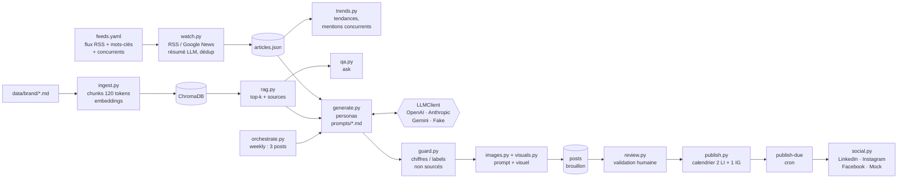

# Copilote Marketing : IA générative + RAG + automatisation social media

MVP réalisé pour la candidature au stage **« Ingénieur(e) IA Générative & Automatisation Social Media »** : une *Content Factory* pour une brasserie artisanale de bières de spécialité certifiées bio, sur le marché franco-belge.

Le copilote :

1. **écoute le marché** (social listening) : flux RSS de la filière, recherches Google News sur des mots-clés (« bière bio CHR ») et sur les **concurrents**, analyse des tendances ;
2. s'appuie sur une **base de connaissances propriétaire (RAG)** (histoire, fiches techniques, labels bio, charte éditoriale, interview), interrogeable directement ;
3. **génère chaque semaine 3 posts** (2 LinkedIn B2B pour cavistes, distributeurs et CHR, 1 Instagram B2C pour les amateurs de craft beer) avec des personas, dans le ton de la marque ;
4. **refuse d'inventer** : chaque chiffre et chaque label est vérifié par un garde-fou ;
5. produit le **visuel** de chaque post (prompt Midjourney / DALL-E, génération via l'API OpenAI ou maquette hors ligne) ;
6. passe par une **validation humaine**, puis **programme et publie** via les API natives (LinkedIn, Instagram, Facebook) ou en simulation.

> **Toutes les données de marque sont fictives** (« Brasserie Démo du Hainaut », son brasseur, ses bières, ses partenaires, le flux de démo). Aucun fait n'est inventé sur une marque réelle. Pour l'adapter à une vraie brasserie, il suffit de remplacer les documents de `data/brand/` puis de lancer `ingest`.

---

## Correspondance avec l'offre

| Mission de l'offre | Implémentation | Commande |
|---|---|---|
| **Veille & social listening** : tendances du marché brassicole, mots-clés des concurrents, actualités CHR/bio | `src/watch.py` (RSS + Google News RSS générés depuis `listening` dans `data/feeds.yaml`), `src/trends.py` (termes fréquents, mentions des mots-clés et concurrents), résumé en 3 phrases + pertinence par le LLM | `watch`, `trends` |
| **Architecture RAG** : base de connaissances propriétaire interrogeable par un LLM | `src/ingest.py` (chunks, embeddings, ChromaDB), `src/rag.py` (top-k + sources), `src/qa.py` (questions-réponses sourcées) | `ingest`, `ask` |
| **Prompt engineering** : posts LinkedIn B2B, légendes Instagram B2C | `prompts/*.md` versionnés et commentés, 3 personas LinkedIn (Expertise Bio, Coulisses du Brassage, Mise en avant d'un distributeur) + 1 persona Instagram, sortie validée par pydantic | `generate` |
| **Génération multimodale** (Midjourney, DALL-E 3) | `src/images.py` (prompt par gabarit : style, palette, composition, interdits, ligne Midjourney), `src/visuals.py` (DALL-E 3 / gpt-image via API, maquette SVG hors ligne) | `visual` |
| **Orchestration & workflow** : publication via API natives | `src/orchestrate.py` (3 posts / semaine), `src/publish.py` (calendrier, `publish-due`), `src/social.py` (LinkedIn Posts API, Instagram Graph API, page Facebook) | `weekly`, `schedule`, `publish-due` |
| **API OpenAI, Anthropic** | `src/llm.py` : interface `LLMClient`, implémentations OpenAI, Anthropic et Gemini, faux client pour les tests | `LLM_PROVIDER` |
| **Respect du ton de la marque** | charte éditoriale dans le RAG et dans le prompt système, mots interdits contrôlés par `src/guard.py`, mini-évaluation | `python -m tests.eval` |

### Le cahier des charges sur 12 semaines, déjà prototypé

| Période | Livrable demandé | État dans ce MVP |
|---|---|---|
| Mois 1, S1-2 | « Brand Book » IA vectorisé, RAG qui répond uniquement à partir des documents | ✅ `ingest` + `ask`, garde-fou sur les chiffres |
| Mois 1, S3-4 | Scripts de veille (flux RSS, Google News « bière bio CHR »), résumés | ✅ `watch` + `trends` |
| Mois 2, S1-2 | Prompt engineering LinkedIn B2B, personas | ✅ 3 personas + Instagram, `generate` |
| Mois 2 | Multimodalité texte + image | ✅ prompts d'images + `visual` (OpenAI ou maquette) |
| Mois 3 | Programmation et publication automatisées, 3 posts par semaine | ✅ `weekly` + `schedule` + `publish-due` (simulation testée, API réelles prêtes à brancher) |

Ce qu'il resterait à faire pendant le stage : brancher la vraie documentation de la marque, obtenir la validation des applications LinkedIn et Meta, choisir le LLM avec la direction, puis affiner les prompts sur les retours de l'équipe et l'engagement réel (voir les pistes d'amélioration).

---

## Architecture



| Module | Rôle |
|---|---|
| `src/config.py` | Chemins, lecture du `.env` |
| `src/models.py` | Modèles pydantic : sortie du LLM (`PostDraft`, `Answer`, `ArticleSummary`) séparée du post stocké (`Post`), statuts et transitions |
| `src/llm.py` | Interface `LLMClient`, implémentations, `complete_json` (extraction JSON, validation, 1 retry) |
| `src/prompts.py` + `prompts/` | Prompts versionnés et commentés |
| `src/ingest.py`, `src/rag.py`, `src/qa.py` | RAG : indexation, retrieval, questions-réponses |
| `src/watch.py`, `src/trends.py` | Veille, social listening, tendances |
| `src/generate.py`, `src/guard.py` | Génération par persona, garde-fou anti-hallucination |
| `src/images.py`, `src/visuals.py` | Prompts d'images, génération des visuels |
| `src/store.py`, `src/review.py` | Stockage JSON, validation humaine |
| `src/publish.py`, `src/social.py`, `src/orchestrate.py` | Calendrier, publication (mock et API réelles), flux hebdomadaire |
| `src/demo.py` | Réponses du mode démo (sans LLM) |
| `src/cli.py` | Interface en ligne de commande |
| `src/web/` | Interface web : API REST FastAPI + page HTML/CSS/JS |

Le design initial est dans [docs/superpowers/specs/](docs/superpowers/specs/2026-10-13-copilote-marketing-design.md).

---

## Installation en 5 commandes

Prérequis : Python 3.11 ou 3.12, puis Git.

```bash
git clone https://github.com/clement-rubin/copilote-marketing-brasserie.git && cd copilote-marketing-brasserie
python -m venv .venv
source .venv/bin/activate        # Windows : .venv\Scripts\activate
pip install -r requirements.txt
cp .env.example .env             # Windows : copy .env.example .env
```

Par défaut, tout tourne **sans clé API ni réseau** (`LLM_PROVIDER=fake`, `IMAGE_PROVIDER=placeholder`, `PUBLISH_MODE=mock`), hors téléchargement initial du modèle d'embedding (environ 470 Mo).

### Interface web

```bash
python -m src.cli ui        # puis ouvrir http://localhost:8765
```

Une interface complète, conçue comme le **registre d'un brasseur** (papier kraft, encre vert bouteille, statuts en tampons d'étiquette) :

| Vue | Ce qu'on y fait |
|---|---|
| **Tableau de bord** | compteurs par statut, prochaines publications, tendances du marché, bouton « Lancer la semaine » |
| **Veille & tendances** | veille démo ou réelle, tendances, mots-clés et concurrents suivis, revue de presse résumée |
| **Atelier de contenu** | choix de l'article de départ et des personas, rédaction des posts avec visuels |
| **Revue** | approuver, rejeter, éditer chaque post ; sources, avertissements du garde-fou, jauge de confiance, prompt d'image à copier |
| **Calendrier** | 4 semaines de créneaux (2 LinkedIn + 1 Instagram), programmation, publication simulée à une date choisie |
| **Base de connaissances** | questions-réponses sourcées sur la documentation de la marque |
| **Contrôle qualité** | mini-évaluation sur 10 cas et test des détecteurs, en un clic |

**Visite guidée intégrée** : elle démarre seule à la première ouverture, puis reste accessible via le bouton « Visite guidée ». En 21 étapes, un projecteur parcourt chaque vue (dont les 9 sections de la Revue) et explique quelle mission de l'offre elle couvre. Les textes s'adaptent au moteur actif : mode démo, ou Gemini / OpenAI / Claude avec le modèle configuré. Navigation avec les flèches, Échap pour quitter.

Côté technique : une **API REST FastAPI** (`src/web/app.py`, documentation automatique sur `/docs`) qui appelle exactement les mêmes fonctions que la CLI, et une page HTML/CSS/JavaScript sans framework (`src/web/static/`). Tout texte venant de l'API est inséré avec `textContent`, jamais `innerHTML` : pas d'injection HTML possible. Usage local, mono-utilisateur, sans authentification.

Démo guidée de toute la chaîne en ligne de commande (Windows) : `powershell -ExecutionPolicy Bypass -File demo.ps1`

## Utilisation

```bash
# Mois 1 : contexte et sourcing
python -m src.cli ingest                                   # indexe data/brand/ dans ChromaDB
python -m src.cli ask "Quel est le degré de la Saison Démo ?"   # question à la base de connaissances
python -m src.cli watch                                    # veille réelle (ou --offline : flux fictif)
python -m src.cli trends                                   # tendances + mentions des concurrents

# Mois 2 : Content Factory
python -m src.cli generate --articles 1                    # 4 brouillons (toutes les personas)
python -m src.cli visual <id>                              # visuel du post (IMAGE_PROVIDER)
python -m src.cli show <id>                                # post complet, sources, avertissements, prompt d'image

# Mois 3 : orchestration
python -m src.cli weekly                                   # veille + 3 brouillons de la semaine + visuels
python -m src.cli review                                   # validation interactive (a/r/e/p/q)
python -m src.cli schedule                                 # programme les posts approuvés
python -m src.cli publish-due                              # publie ce qui est arrivé à échéance
python -m src.cli list                                     # état de tous les posts
python -m src.cli export <id> <id>                         # export markdown pour l'équipe
```

Autres options : `review --approve <id> --reject <id> --note "..."`, `review --edit <id> --text "..."`, `visual <id> --url https://...` (URL publique du visuel, exigée par Instagram), `publish-due --live`, `publish-due --at 2026-12-31` (simulation).

### Automatisation

Deux jobs suffisent : un passage hebdomadaire de veille et génération, puis un passage fréquent de publication. Entre les deux, la revue humaine reste obligatoire.

```bash
# cron (Linux / macOS)
0 8 * * 1    cd /chemin/copilote-marketing-brasserie && .venv/bin/python -m src.cli weekly
*/15 * * * * cd /chemin/copilote-marketing-brasserie && .venv/bin/python -m src.cli publish-due
```

```bat
:: Planificateur de tâches Windows
schtasks /Create /SC WEEKLY /D MON /ST 08:00 /TN "Copilote weekly" /TR "cmd /c cd /d C:\dev\copilote-marketing && .venv\Scripts\python -m src.cli weekly"
schtasks /Create /SC MINUTE /MO 15 /TN "Copilote publication" /TR "cmd /c cd /d C:\dev\copilote-marketing && .venv\Scripts\python -m src.cli publish-due"
```

Les mêmes commandes peuvent être appelées depuis n8n ou Make (nœud « Execute Command ») si l'équipe préfère un outil visuel.

### Brancher les vrais fournisseurs

Dans `.env` :

```ini
LLM_PROVIDER=gemini            # ou openai, anthropic
GEMINI_API_KEY=...             # clé gratuite sur Google AI Studio
GEMINI_MODEL=gemini-3.1-flash-lite,gemini-3.8-flash   # le 2e sert de secours si le 1er est saturé
IMAGE_PROVIDER=openai          # DALL-E 3 / gpt-image, avec OPENAI_API_KEY
IMAGE_MODEL=dall-e-3
PUBLISH_MODE=live              # + tokens LinkedIn / Meta, voir plus bas
```

Aucun nom de modèle n'est écrit dans le code. Chaque appel a un délai maximal de 60 s et des réessais (2 s, 4 s) sur les erreurs temporaires (429, 5xx). Avec Gemini, si un modèle est saturé, retiré ou trop lent, le suivant de la liste prend le relais.

### Tests et évaluation

```bash
python -m pytest            # 82 tests, sans réseau ni clé (API sociales simulées, API web via TestClient)
python -m tests.eval        # mini-évaluation sur 10 cas avec le LLM configuré
```

---

## Exemple de sortie (Gemini, réel)

Les exemples de [`out/examples/`](out/examples/) ont été produits par la vraie chaîne avec **Gemini** (`gemini-3.1-flash-lite`) : `watch` → `generate` → **relecture humaine** → `schedule` → `export`. Chaque fichier indique le modèle et la note de revue humaine.

Post LinkedIn, persona « Mise en avant d'un distributeur » (extrait, non retouché) :

```text
Les consommateurs sont de plus en plus nombreux à chercher du sens derrière les étiquettes et à privilégier
les circuits courts pour leurs achats. Chez Brasserie Démo du Hainaut, nous constatons cette évolution au
quotidien grâce à nos partenaires comme la Cave « Le Tonneau Démo » à Mons. Caviste indépendant travaillant
avec nous depuis 2018, ils ont su intégrer nos bières certifiées bio dans leur sélection, tout en animant la
vie locale avec leur soirée de dégustation organisée chaque premier vendredi du mois. [...]

Sources : 08_faq_distributeurs.md, 01_histoire.md, … · Avertissement : « Vérifier l'accord écrit du partenaire »
```

Légende Instagram (tutoiement, 5 hashtags) :

```text
Tu cherches une bière brassée avec des céréales certifiées bio ? Depuis 2017, c'est notre seule façon de
travailler. Passe donc nous voir ce jeudi soir à la grange pour une dégustation, on t'attend pour échanger
autour d'un verre 🍻 À consommer avec modération.
#BrasserieDemoDuHainaut #BiereBio #BiereArtisanale #CraftBeer #Hainaut
```

**Ce que la relecture humaine a corrigé** (détail dans chaque fichier d'exemple) :

| Post | Problème | Détecté par |
|---|---|---|
| Expertise Bio | « notre meilleur argument » (superlatif interdit) | **garde-fou** |
| Expertise Bio | « toutes nos bières sont certifiées » : trop large, les éditions saisonnières ne le sont pas toujours | relecture humaine |
| Instagram | aucun émoji (la charte en demande 1 à 3) | garde-fou (règle ajoutée après ce cas) |
| Coulisses du Brassage | « Depuis 2017, c'est ici que nos journées commencent » : la brasserie est fondée en 2016, 2017 est la date de la certification bio. **Post rejeté** | relecture humaine : le chiffre existe dans les sources, le garde-fou ne peut pas voir l'erreur de sens |

Base de connaissances (`ask`, Gemini) :

```text
Q : Êtes-vous labellisés Biogarantie ?
R : Non, notre brasserie n'est pas labellisée Biogarantie. Nous sommes toutefois certifiés bio depuis 2017
    selon le règlement européen […]. Une candidature pour le label Biogarantie est à l'étude pour 2027.
    (06_labels_bio.md)

Q : Quel est le prix d'un fût de Blonde ?
R : Je ne trouve pas cette information dans la documentation.
```

### L'évaluation a guidé l'itération des prompts

| Version des prompts | Cas conformes | Chiffres ou labels non sourcés | Problèmes |
|---|---|---|---|
| v1 | 8 / 10 | **0** | post distributeur trop court (528 car.), « meilleur » sur Instagram |
| v2 (structure en 3 paragraphes, superlatifs listés, tutoiement explicite) | **10 / 10** | **0** | — |

Les changements sont tracés en tête de chaque fichier `prompts/persona_*.md`. Il s'agit d'une seule exécution par version : avec un LLM, il faudrait plusieurs passages pour une conclusion statistique.

Contrôle des détecteurs (inclus dans l'évaluation) :

```text
degré + label inventés        Chiffre non sourcé : 8 · Label non sourcé : Demeter
superlatifs + santé + émojis  Formule interdite : « meilleure bière », « incroyable », « bonne pour la santé »
```

Sans clé API, `LLM_PROVIDER=fake` fait tourner toute la chaîne hors ligne : le `FakeLLMClient` assemble des phrases tirées des passages RAG (style plat, mais même code de validation).

---

## Choix techniques

| Choix | Pourquoi |
|---|---|
| **Appels directs plutôt que LangChain** | L'offre cite LangChain à titre d'exemple. Ici, les besoins se limitent à découper, vectoriser, interroger et faire un appel LLM : sans framework, il y a moins de dépendances et de couches, et chaque ligne s'explique. L'interface `LLMClient` joue le rôle d'abstraction. LangChain se justifierait pour des agents ou des chaînes plus complexes. |
| **ChromaDB plutôt que Pinecone** | Embarquée, persistante, gratuite, rien à héberger : adaptée à quelques centaines de documents. Pinecone devient pertinent pour un volume ou un accès multi-utilisateur plus important. Seuls `ingest.py` et `rag.py` seraient à adapter. |
| **Interface `LLMClient`** | OpenAI, Anthropic et Gemini sont interchangeables par une variable d'environnement, avec un faux client pour des tests gratuits et déterministes. On n'est pas lié à un fournisseur. |
| **Embeddings locaux** (`paraphrase-multilingual-MiniLM-L12-v2`) | Gratuit, hors ligne, multilingue (documents en français, veille en anglais), aucune donnée interne envoyée à un tiers pour l'indexation. |
| **Chunks de 120 tokens**, chevauchement 30 | Ce modèle **tronque à 128 tokens** : avec des chunks de 500 tokens, les trois quarts du texte ne seraient pas vectorisés. Le comptage utilise le tokenizer du modèle. Le découpage se fait par section markdown puis par phrase, et chaque chunk est préfixé par « Document > Section ». |
| **RSS et API plutôt que scraping** | L'offre parle de « Scraping/API ». J'ai retenu les flux RSS et Google News RSS, publiés volontairement par les éditeurs. Le scraping de pages pose des questions de CGU, de droit d'auteur et de RGPD, et casse à chaque changement de site. Si un scraper devenait nécessaire, il respecterait `robots.txt`, un délai entre requêtes et les CGU du site. |
| **Charte exclue des sources de faits** | Elle contient des exemples de « mauvais posts » : ils ne doivent jamais servir de source. Le ton passe par le prompt système. |
| **Deux familles de modèles pydantic** | `PostDraft` = ce que le LLM a le droit de produire. `Post` ajoute ce que seul le code contrôle (id, statut, dates). Le LLM ne peut pas s'auto-approuver ni s'auto-publier. |
| **Prompts dans `prompts/*.md`** | Versionnés, commentés, relisibles par l'équipe marketing sans lire de Python. |
| **Prompts d'images par gabarit** | Une direction artistique stable : même palette et mêmes interdits à chaque post. L'API d'images ne fait que l'exécuter. |
| **Midjourney** | Pas d'API publique officielle : le prompt contient une ligne « Midjourney : ... » à coller dans l'outil. |
| **Publication en deux jobs** (`schedule` puis `publish-due`) | Les API LinkedIn et Instagram ne programment pas les posts elles-mêmes. Notre calendrier est la source de vérité, et un job publie à l'échéance. Un échec est retenté sans republier les canaux déjà réussis. |

### Anti-hallucination, en trois couches

1. **Prompt** ([prompts/system.md](prompts/system.md)) : les passages sont étiquetés `[source: fichier]`, et toute information manquante doit aller dans `avertissements`.
2. **Code** ([src/guard.py](src/guard.py)) : chaque **nombre** et chaque **label** du texte doit figurer dans le contexte fourni. Le code contrôle aussi les **formules interdites** par la charte, les **sources inventées** (retirées) et la **forme** (longueur, hashtags, émojis). Chaque problème de fond ajoute un avertissement et baisse le score de confiance.
3. **Humain** : tout post naît brouillon. Seuls les posts approuvés sont programmables, et toute édition renvoie le post en brouillon après une nouvelle vérification.

Le contexte complet fourni au LLM est enregistré dans chaque post : chaque affirmation peut être auditée après coup.

---

## API sociales : ce qui est prêt, ce qu'il faut obtenir

Les publishers de `src/social.py` sont écrits d'après la documentation officielle et testés avec un faux transport HTTP. Ils n'ont **pas** été appelés contre les vraies API : il faut pour cela des applications validées par LinkedIn et Meta. À revalider avant la mise en production, car les deux plateformes versionnent leurs API.

### LinkedIn (page entreprise)

- Application sur le LinkedIn Developer Portal, **associée à la page** de la brasserie (vérifiée par un administrateur).
- Accès au produit **Community Management API** : demande et revue par LinkedIn.
- **OAuth 2.0** avec un administrateur de la page, scope `w_organization_social`.
- Implémenté : `POST /rest/posts` avec les en-têtes `LinkedIn-Version` et `X-Restli-Protocol-Version: 2.0.0`, échappement du *little text format*, hashtags au format LinkedIn. À ajouter : l'envoi d'image (Images API).
- **Tokens** à durée limitée à renouveler, à stocker dans un coffre à secrets. **Quotas** quotidiens visibles dans le portail.

### Instagram et Facebook (Meta)

- **Compte Instagram professionnel** relié à une **page Facebook** (ou API « Instagram Login »).
- **Application Meta**, **App Review** des permissions de publication (`instagram_content_publish` ou `instagram_business_content_publish`, et les permissions de page pour Facebook), souvent avec **vérification de l'entreprise**.
- Implémenté : publication Instagram en deux temps (`/{ig-user-id}/media` puis `/media_publish`) ; l'image doit être à une **URL publique** (`visual <id> --url ...`). Relais facultatif sur la page Facebook (`/{page-id}/feed` ou `/photos`).
- **Quota de publications par 24 h glissantes** (endpoint `content_publishing_limit`), limites de débit de la Graph API, **tokens longue durée** à rafraîchir.

---

## Limites connues

- **Le garde-fou vérifie la présence, pas le sens.** « Nous sommes labellisés Biogarantie » passe le contrôle des labels, parce que le mot figure dans le contexte… dans la phrase qui dit que nous ne l'avons PAS. Un chiffre attribué à la mauvaise bière passe aussi. La relecture humaine reste indispensable.
- **Hallucinations non chiffrées** : un nom, une anecdote ou une citation inventés ne sont pas détectés automatiquement.
- **Erreurs de sens avec des chiffres exacts** : cas réel observé avec Gemini, « depuis 2017, c'est ici que nos journées commencent » (2017 est la date de la certification, pas de l'ouverture). Seule la relecture humaine l'a vu.
- **Ratés du retrieval** : à la question « avec quoi servir la Saison ? », le passage des accords mets n'était pas dans le top 6 ; le modèle a répondu que l'information manquait. L'échec est sûr (rien d'inventé), mais incomplet.
- **Score de confiance** : c'est une auto-évaluation du modèle corrigée par des règles, pas une probabilité calibrée.
- **Mode démo** : ce n'est pas un LLM. Les textes sont exacts mais peu rédigés.
- **Social listening limité au texte des flux** : pas d'accès aux posts des concurrents sur LinkedIn ou Instagram. Leurs API ne le permettent pas sans partenariat, et le scraping de ces plateformes est interdit par leurs CGU. Les liens Google News sont des redirections, donc la déduplication par URL peut laisser passer un même article venu de deux sources.
- **Publishers réels non testés en conditions réelles** (voir plus haut).
- **Coût et quotas** : 1 appel LLM par article résumé, 1 par post (plus 1 retry si le JSON est invalide), 1 appel d'image par visuel. `max_items_per_feed` borne le volume.
- **RGPD et confidentialité** : sur les offres gratuites, les données envoyées peuvent servir à l'entraînement : il ne faut pas y envoyer d'informations confidentielles. Les seules données personnelles traitées sont celles des partenaires mis en avant, ce qui exige leur accord écrit (avertissement automatique).
- **Mono-utilisateur** : stockage JSON sans verrou ni authentification.

## Pistes d'amélioration (approche growth)

- **Boucle de performance** : récupérer l'engagement des posts publiés (LinkedIn Analytics, Instagram Insights), comparer les personas et les accroches, réinjecter les meilleurs posts comme exemples dans les prompts.
- **A/B testing** : générer deux accroches par post et alterner.
- **Vérification au niveau des affirmations** : un juge LLM ou un modèle NLI qui vérifie chaque phrase contre les passages.
- **Retrieval** : recherche hybride (BM25 + vecteurs), reranker, modèle d'embedding à fenêtre plus longue.
- **Interface multi-utilisateur** : authentification, rôles (rédaction, direction), notifications (mail, Slack) quand les brouillons de la semaine sont prêts.
- **Images** : hébergement automatique des visuels validés (stockage objet) pour fournir l'URL publique à Instagram.

## Structure du dépôt

```
copilote-marketing/
  data/brand/            8 documents fictifs (histoire, charte, 3 fiches bières, labels, interview, FAQ)
  data/feeds.yaml        flux RSS + social listening (mots-clés, concurrents)
  data/demo_feed.xml     flux fictif pour la démo hors ligne
  prompts/               prompts versionnés et commentés
  src/                   code (voir le tableau des modules)
  tests/                 76 tests + eval.py
  out/examples/          exemples de sortie (2 LinkedIn, 1 Instagram, 1 programmation)
  demo.ps1               démo guidée
  docs/                  spec de design
```
