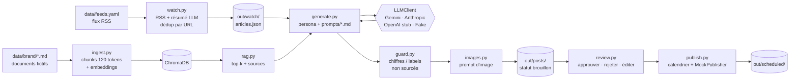

# Copilote Marketing : RAG + LLM pour une brasserie artisanale bio

MVP de démonstration d'un **copilote marketing** pour une brasserie artisanale bio. Il :

1. **surveille l'actualité du marché** via des flux RSS (bière, brasserie artisanale, bio, CHR) et résume chaque article ;
2. **génère des posts LinkedIn (B2B) et Instagram (B2C)** fidèles au ton de la marque, en s'appuyant sur un **RAG** comme seule source de faits ;
3. **refuse d'inventer** : chaque chiffre et chaque label est vérifié par un garde-fou déterministe ;
4. fait passer chaque post par une **validation humaine**, puis le **programme** (2 LinkedIn + 1 Instagram par semaine) ;
5. propose un **prompt d'image** cohérent avec la marque pour chaque post.

> **Toutes les données de marque sont fictives.** La « Brasserie Démo du Hainaut », son brasseur, ses bières, ses partenaires et le flux de démonstration sont inventés pour ce projet. Seules les informations générales sur la réglementation bio européenne sont réelles, et elles sont résumées.

---

## Architecture



| Module | Rôle |
|---|---|
| `src/config.py` | Chemins du projet, lecture du `.env` |
| `src/models.py` | Modèles pydantic : sortie du LLM (`PostDraft`) séparée du post stocké (`Post`), statuts et transitions |
| `src/llm.py` | Interface `LLMClient` + implémentations, `complete_json` (extraction JSON, validation, 1 retry) |
| `src/prompts.py` + `prompts/*.md` | Prompts versionnés et commentés (les commentaires ne sont pas envoyés au LLM) |
| `src/ingest.py` | Découpage des documents de marque, vectorisation, ChromaDB |
| `src/rag.py` | Retrieval top-k, filtre par type de document, citation des sources |
| `src/watch.py` | Veille RSS, résumé en 3 phrases + pertinence, déduplication par URL |
| `src/generate.py` | Génération des posts par persona |
| `src/guard.py` | Garde-fou anti-hallucination et contrôle de forme |
| `src/images.py` | Prompts d'images (Midjourney / DALL-E), sans appel d'API |
| `src/store.py` | Stockage JSON des posts |
| `src/review.py` | File de validation humaine |
| `src/publish.py` | Interface `Publisher`, `MockPublisher`, calendrier |
| `src/demo.py` | Réponses du mode démo (sans LLM) |
| `src/cli.py` | Commandes `ingest`, `watch`, `generate`, `list`, `show`, `review`, `schedule`, `export` |

Le design détaillé est dans [docs/superpowers/specs/2026-10-13-copilote-marketing-design.md](docs/superpowers/specs/2026-10-13-copilote-marketing-design.md).

---

## Installation en 5 commandes

Prérequis : Python 3.11 ou 3.12, puis Git.

```bash
git clone <url-du-depot> && cd copilote-marketing
python -m venv .venv
source .venv/bin/activate        # Windows : .venv\Scripts\activate
pip install -r requirements.txt
cp .env.example .env             # Windows : copy .env.example .env
```

Par défaut, `LLM_PROVIDER=fake` : **tout fonctionne sans clé API ni réseau** (hors téléchargement initial du modèle d'embedding, environ 470 Mo).

## Utilisation

```bash
python -m src.cli ingest                     # indexe data/brand/ dans ChromaDB
python -m src.cli watch --offline            # veille sur le flux fictif (sans --offline : vrais flux RSS)
python -m src.cli generate --articles 1      # 4 brouillons : 3 personas LinkedIn + 1 Instagram
python -m src.cli list                       # liste les posts et leur statut
python -m src.cli show <id>                  # post complet + sources + avertissements + prompt d'image
python -m src.cli review                     # validation interactive (a/r/e/p/q)
python -m src.cli review --approve <id> --reject <id> --note "..."   # validation non interactive
python -m src.cli review --edit <id> --text "nouveau texte"         # édition (repasse en brouillon)
python -m src.cli schedule                   # programme les posts approuvés
python -m src.cli export <id> <id>           # export markdown dans out/examples/
```

Options utiles : `generate --persona expertise_bio --persona instagram_craft`, `list --statut approuve`.

Démo guidée de toute la chaîne, avec des pauses (Windows) : `powershell -ExecutionPolicy Bypass -File demo.ps1`

### Utiliser un vrai LLM

Gemini (quota gratuit) : créer une clé sur [Google AI Studio](https://aistudio.google.com/apikey), puis dans `.env` :

```ini
LLM_PROVIDER=gemini
GEMINI_API_KEY=...
GEMINI_MODEL=gemini-2.5-flash
```

Anthropic : `LLM_PROVIDER=anthropic`, `ANTHROPIC_API_KEY`, `ANTHROPIC_MODEL`. Le nom du modèle n'est jamais écrit en dur dans le code.

### Tests et évaluation

```bash
python -m pytest            # 52 tests, sans réseau ni clé (mode démo + vrai modèle d'embedding)
python -m tests.eval        # mini-évaluation sur 10 cas, avec le LLM configuré
```

---

## Exemple de sortie

> Les exemples de [`out/examples/`](out/examples/) ont été produits par la vraie chaîne (`watch --offline` → `generate` → `review` → `schedule` → `export`) en **mode démo** : le « LLM » est le `FakeLLMClient`, qui assemble des phrases tirées des passages RAG. Le style est donc plus plat qu'avec un vrai modèle, mais les sorties passent par exactement le même code : parsing JSON, validation pydantic, garde-fou, prompt d'image, validation, programmation. Avec une clé Gemini, la même commande produit des textes rédigés par le modèle.

Post LinkedIn, persona « Expertise Bio » ([fichier complet](out/examples/)) :

```text
Le logo bio, tout le monde le connaît. Ce qu'il garantit, beaucoup moins.

Dans l'actualité cette semaine : « Les cavistes indépendants misent sur les bières bio locales ». Ça nous parle.

Le logo bio européen, appelé « Eurofeuille », est obligatoire sur les produits bio préemballés de l'Union
européenne. Il garantit qu'au moins 95 % des ingrédients d'origine agricole sont issus de l'agriculture
biologique. [...]

Vous êtes caviste ou restaurateur ? Quelle question vos clients vous posent-ils le plus sur le bio ?

#BiereBio #BiereArtisanale #CavisteIndependant

Sources : 06_labels_bio.md · Confiance : 0.60 · Statut : programmé mar. 20/10/2026 09h00
```

Programmation produite par `schedule` :

```text
┌───────────────────────┬────────────┬──────────┬──────────────────────────────────────────────────┐
│ date                  │ plateforme │ id       │ début du texte                                   │
├───────────────────────┼────────────┼──────────┼──────────────────────────────────────────────────┤
│ mar. 20/10/2026 09h00 │ linkedin   │ 5a49c62f │ Le logo bio, tout le monde le connaît. Ce qu'il… │
│ jeu. 22/10/2026 09h00 │ linkedin   │ 62434694 │ Une bière ne se vend pas toute seule. Merci à c… │
│ sam. 24/10/2026 11h00 │ instagram  │ 07d9caf8 │ Petite pause dégustation à la grange 🍻 Aujourd… │
└───────────────────────┴────────────┴──────────┴──────────────────────────────────────────────────┘
```

Mini-évaluation (`python -m tests.eval`, mode démo) :

```text
10/10 cas conformes, confiance moyenne 0.60

Contrôle des détecteurs (posts volontairement fautifs)
degré + label inventés        Chiffre non sourcé : 8 · Label non sourcé : Demeter
superlatifs + santé + émojis  Formule interdite : « meilleure bière », « incroyable »,
                              « bonne pour la santé » · 16 émojis (maximum 3)
```

---

## Choix techniques

| Choix | Pourquoi |
|---|---|
| **Pas de LangChain** | Les besoins se limitent à découper, vectoriser, interroger et faire un appel LLM. Les appels directs à ChromaDB et aux SDK font moins de code, moins de dépendances, et chaque ligne s'explique. |
| **Interface `LLMClient`** | Le reste du code n'appelle que `complete()`. Changer de fournisseur revient à changer une variable d'environnement. Gemini et Anthropic sont implémentés, OpenAI est un stub documenté. |
| **`FakeLLMClient` + mode démo** | Les tests ne coûtent rien, ne dépendent pas du réseau et sont déterministes. La démo tourne sans clé. |
| **Embeddings locaux** (`paraphrase-multilingual-MiniLM-L12-v2`) | Gratuit, hors ligne, multilingue (documents en français, flux en anglais), aucune donnée de marque envoyée à un tiers pour l'indexation. |
| **Chunks de 120 tokens**, chevauchement 30 | Ce modèle **tronque à 128 tokens** : avec des chunks de 500 tokens, les trois quarts du texte ne seraient pas vectorisés. On compte avec le tokenizer du modèle lui-même, on découpe par section markdown puis par phrase, et on préfixe chaque chunk par « Document > Section ». |
| **ChromaDB** | Base vectorielle embarquée et persistante, rien à installer. On fournit nos propres embeddings : on maîtrise le modèle. |
| **Charte exclue des sources de faits** | Elle contient des exemples de « mauvais posts » : ils ne doivent jamais servir de source. Le ton est donné par le prompt système. |
| **pydantic, deux modèles distincts** | `PostDraft` = ce que le LLM a le droit de produire. `Post` ajoute ce que seul le code contrôle (id, statut, dates). Le LLM ne peut pas s'auto-approuver. |
| **Prompts dans `prompts/*.md`** | Versionnés avec le code, commentés (`<!-- -->`, non envoyés), relisibles par l'équipe marketing sans lire de Python. |
| **Garde-fou déterministe** | Le prompt réduit les hallucinations, le code les attrape. Voir ci-dessous. |
| **Prompts d'image par gabarit** | Une direction artistique doit être stable : même palette et mêmes interdits à chaque post, sans coût ni variabilité. |
| **Stockage JSON** | Lisible, versionnable, suffisant pour un MVP mono-utilisateur. |
| **RSS uniquement** | Pas de scraping : on ne lit que ce que l'éditeur publie volontairement en flux. Le LLM résume le titre et l'extrait RSS, la page n'est jamais téléchargée. |

### Anti-hallucination, en trois couches

1. **Prompt** ([prompts/system.md](prompts/system.md)) : les passages sont étiquetés `[source: fichier]`, et toute information manquante doit aller dans `avertissements`.
2. **Code** ([src/guard.py](src/guard.py)), après génération :
   - chaque **nombre** du post (degré, %, année, volume) doit apparaître dans les passages RAG ou l'article fourni ;
   - chaque **label** connu (Eurofeuille, Biogarantie, Demeter…) doit apparaître dans le contexte ;
   - **formules interdites** par la charte (superlatifs, allégations santé) ;
   - **sources inventées** (fichiers non fournis) retirées et signalées ;
   - chaque problème de fond ajoute un avertissement et retire 0,2 au score de confiance.
3. **Humain** : tout post naît brouillon. Seuls les posts approuvés sont programmables, et toute édition renvoie le post en brouillon après une nouvelle vérification.

Le contexte complet fourni au LLM est enregistré dans le post (`contexte`) : on peut auditer chaque affirmation après coup.

---

## Brancher les vraies API sociales

`MockPublisher` écrit dans `out/scheduled/`. Pour publier vraiment, il suffit d'écrire une classe `LinkedInPublisher(Publisher)` ou `InstagramPublisher(Publisher)`, sans toucher au reste. Côté plateformes, voici ce qu'il faudrait (à vérifier dans la documentation officielle, ces conditions évoluent souvent).

### LinkedIn (page entreprise)

- **Application** créée sur le LinkedIn Developer Portal et **associée à la page** de la brasserie (vérification par un administrateur de la page).
- **Accès au produit « Community Management API »**, soumis à une demande et à une revue par LinkedIn (palier de développement, puis palier standard).
- **OAuth 2.0** (3-legged) avec un compte administrateur de la page, scope `w_organization_social` (et `r_organization_social` pour lire).
- Publication via la **Posts API** (`POST /rest/posts`, en-têtes `LinkedIn-Version` et `X-Restli-Protocol-Version: 2.0.0`). Les images s'envoient d'abord via l'Images API.
- **Tokens** à durée limitée, à renouveler (refresh token selon le programme), et à stocker hors du code (coffre à secrets).
- **Limites de débit** quotidiennes par application et par membre, visibles dans le portail développeur.
- Pas de programmation native via l'API : notre `schedule` reste la source de vérité, et un job (cron, file de tâches) publie à l'heure prévue.

### Instagram (Meta)

- **Compte Instagram professionnel** (Business ou Créateur). Selon l'API choisie, il doit aussi être relié à une **page Facebook** (Instagram Graph API avec Facebook Login) ou passer par l'API « Instagram Login ».
- **Application Meta** avec **App Review** pour les permissions de publication (ex. `instagram_content_publish` / `instagram_business_content_publish`), et souvent la **vérification de l'entreprise**.
- Publication en deux temps : création d'un *media container* (`POST /{ig-user-id}/media` avec `image_url` publique et `caption`), puis `POST /{ig-user-id}/media_publish`. **L'image doit donc être hébergée à une URL publique.**
- **Quota de publications par 24 h glissantes**, consultable via l'endpoint `content_publishing_limit`, en plus des limites de débit de la Graph API.
- **Tokens longue durée** (environ 60 jours) à rafraîchir.

---

## Limites connues

- **Le garde-fou vérifie la présence, pas le sens.** « Nous sommes labellisés Biogarantie » passe le contrôle des labels, parce que « Biogarantie » figure dans le contexte… dans la phrase qui dit que nous ne l'avons PAS. De même, « 6,5 % » attribué à la mauvaise bière passe. La relecture humaine reste indispensable. Une vérification au niveau des affirmations est listée dans les pistes.
- **Hallucinations non chiffrées** : un nom, une anecdote ou une citation inventés ne sont pas détectés automatiquement.
- **Score de confiance** : c'est une auto-évaluation du modèle, corrigée par des règles. Ce n'est pas une probabilité calibrée.
- **Mode démo** : ce n'est pas un LLM. Les textes sont corrects factuellement mais peu rédigés.
- **RSS** : les extraits sont souvent courts. Les liens Google News sont des redirections, donc deux sources peuvent pointer vers le même article sans que la déduplication par URL le voie.
- **Coût et quotas** : chaque article coûte 1 appel (résumé) et chaque post 1 appel (avec 1 retry en cas de JSON invalide). Le quota gratuit de Gemini limite le nombre d'appels par minute et par jour. `max_items_per_feed` borne le volume.
- **RGPD et confidentialité** : sur les offres gratuites, les données envoyées peuvent être utilisées par le fournisseur pour améliorer ses modèles. Il ne faut pas y envoyer d'informations confidentielles (tarifs, données de partenaires). Les seules données personnelles traitées sont celles des partenaires mis en avant : il faut leur accord écrit (la persona l'ajoute en avertissement).
- **Droit d'auteur et CGU** : on ne republie pas les articles, on en tire un angle et on garde le lien. Les conditions d'utilisation de chaque flux restent à vérifier pour un usage commercial.
- **Mono-utilisateur** : stockage JSON sans verrou ni authentification, pas d'historique des versions d'un post.

## Pistes d'amélioration

- **Vérification au niveau des affirmations** : découper le post en affirmations et vérifier chacune contre les passages (NLI, ou un second LLM « juge » avec citation obligatoire).
- **Retrieval** : recherche hybride (BM25 + vecteurs), reranker, modèle d'embedding à fenêtre plus longue (ex. `multilingual-e5`).
- **Évaluation** : jeu de référence annoté par l'équipe marketing, mesure du ton (respect de la charte) par un juge LLM, suivi des scores d'une version de prompt à l'autre.
- **Interface de revue** (Streamlit ou petite app web) pour l'équipe marketing, avec historique des éditions.
- **Vrais publishers** LinkedIn et Instagram, avec un job planifié et des tentatives de reprise.
- **Images** : génération réelle (avec validation humaine), hébergement pour l'API Instagram.
- **Coûts** : cache des résumés, prompt caching, suivi des tokens par commande.
- **Boucle de retour** : réintégrer les posts approuvés et leurs statistiques d'engagement comme exemples dans les prompts.

## Structure du dépôt

```
copilote-marketing/
  data/brand/            8 documents fictifs (histoire, charte, 3 fiches bières, labels, interview, FAQ)
  data/feeds.yaml        flux RSS configurables
  data/demo_feed.xml     flux fictif pour la démo hors ligne
  prompts/               prompts versionnés et commentés
  src/                   code (voir le tableau des modules)
  tests/                 tests unitaires + intégration + eval.py
  out/examples/          exemples de sortie (2 LinkedIn, 1 Instagram, 1 programmation)
  docs/                  spec de design
```
